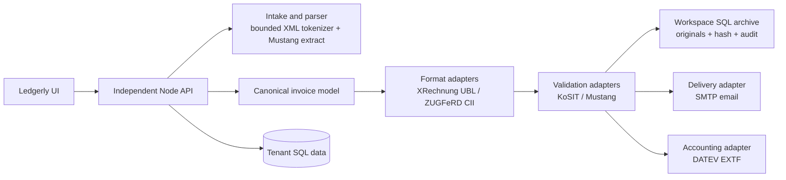

# Independent E-invoicing Workflows

Each workflow has its own API entry point and adapter module. The browser submits a canonical invoice or source document; it does not create compliance artifacts or talk directly to SMTP, KoSIT, Mustang, or DATEV.

## Workflow boundaries

| Workflow | Entry point | Implementation | Output |
|---|---|---|---|
| Manual customer and invoice entry | `/customers.html`, `/invoices.html` | `/api/customers`, `/api/invoices`, workspace profile API | Tenant-scoped records and invoice drafts |
| File intake | `/delivery.html` Incoming tab | `POST /api/inbound`, `parser.mjs`, optional Mustang PDF extraction | Parsed canonical preview, extraction findings, validation result, retained original |
| Format generation | Invoice draft detail | `POST /api/invoices/:id/artifacts`, `model.mjs`, Mustang adapter for PDF/A-3 | XRechnung UBL XML, or ZUGFeRD PDF/A-3 with embedded CII when configured |
| Validation | `/validation.html` | `POST/GET /api/validation`, KoSIT adapter; Mustang validates ZUGFeRD output | Durable report, ruleset ID, and an explicit outcome; unknown/unavailable never means accepted |
| Email delivery | `/delivery.html` Outbox tab | `POST/GET /api/deliveries`, `email.mjs` | Provider result and delivery history; only accepted artifacts can be sent |
| DATEV export | `/archive.html` Exports tab | `POST/GET /api/exports/datev`, `datev.mjs` | Downloadable DATEV EXTF booking batch with explicit account and tax-key settings |
| Archive | `/archive.html` Archive tab | `archive.mjs`, `/api/archive`, `/api/audit/verify` | Exact document bytes, digest, retention target, and audit events in SQL |

## Replacement points

- The REST API is the stable boundary between the static UI and services. `LEDGERLY_API_BASE` can point the UI to a separately deployed API.
- `parser.mjs` can be replaced by another UBL/CII/PDF parsing provider while keeping the canonical `invoice` shape returned by `parseInvoiceXml`.
- `model.mjs` owns canonical totals and party data. Format adapters take that model; format syntax is not stored as the primary invoice record.
- KoSIT, Mustang, SMTP, and DATEV file generation are distinct modules. Peppol, API/EDI, and direct DATEV APIs can be added as additional delivery/export adapters without replacing the existing flows.
- Uploaded input, validation evidence, generated artifacts, and accounting exports have separate database records and IDs. A draft is not treated as a sent invoice.

## Operational configuration

1. **XRechnung:** `npm run setup:kosit` downloads and hash-verifies KoSIT Validator 1.6.3 and XRechnung 3.0.2. Start the private local daemon with `npm run start:kosit`; `npm run test:kosit` checks both acceptance and rejection.
2. **ZUGFeRD:** `npm run setup:mustang` downloads and hash-verifies Mustang CLI 2.26.0. Generation requires the human-readable PDF source; Mustang combines it with generated CII XML as PDF/A-3 and validates the final document.
3. **Email:** each workspace owner configures SMTP in Settings → Delivery & SMTP; passwords are encrypted with the API server key.
4. **DATEV:** the workspace admin supplies the client/consultant numbers, account framework, ledger accounts, period and VAT-key mapping. The file is available for download; the export is not pushed to a DATEV account automatically.

Peppol, API/EDI, direct DATEV API and Stripe still require separate connectors or credentials and return explicit blocked/unavailable states. KoSIT passing is not a government certification, and the SQL archive is not by itself a GoBD certification or WORM storage system.
